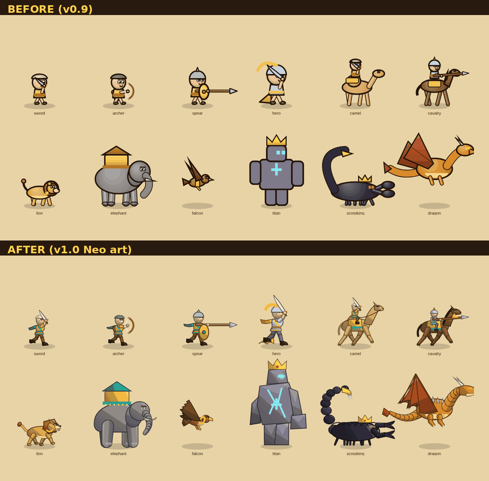

# حرب الرمال · Sand Wars (web prototype)

A playable HTML5 prototype of the «حرب الرمال» Stickman lane-battle game, built from the PRD of Nov 23, 2026.
It's for checking the core loop, balance and UX before committing to a Unity/Godot Android build. It can also be wrapped as an Android app (Capacitor or a TWA).

## Run

```bash
npm install
npm run dev        # http://localhost:5173
npm run build      # production build in dist/
```

Every push to `main` deploys to GitHub Pages through `.github/workflows/pages.yml`.

Desktop keys: `1–9` train units · `Shift`+`1–9` toggle auto-train · `F` change formation · `E` take/release control · `A`/`D` move · `Space` attack (tap on time for a Perfect strike) · `Q` commander ability.

## What's implemented (PRD mapping)

| PRD | Status |
|---|---|
| §4 Battle: single lane, forts + mines, 2 miners + 150 gold start, 5 gold / 3 s per miner, max 8 miners | ✅ |
| §4 Train queue with cost + time, Defend / Hold / Attack modes | ✅ |
| §4 Direct control of one unit (+30% damage), on-screen ◀ ▶ ⚔ pad | ✅ |
| §4 Commander ability (Arrow Volley) on a charge meter | ✅ (one ability; more come with the skill tree) |
| §4 Stars: win · fort > 50% · under 3 min; double loot via rewarded ad | ✅ |
| §4 Enemy AI: pre-built wave scripts + defend when you push + counters your most-built unit | ✅ |
| §5 Six player units with the counter triangle (spear > camel > archer > spear) | ✅ |
| §5 40 levels, 4 regions (oasis, red dunes with sandstorm, mountains, night city), 4 bosses | ✅ |
| §6 Unit upgrades 1–20 (+8% / level, cost doubles every 4 levels) | ✅ |
| §6 7-day reward calendar, 3 daily quests, free chest every 4 h (+ ad to open now, 5/day) | ✅ |
| §6 Gear, skill tree, cosmetics | ⏳ not yet |
| §7 Rewarded placements: double loot, revive at 50%, chest, +150 starting gold (3/day) | ✅ mock ads |
| §7 Interstitial rules: after result only, level ≥ 6, ≤ 1 per 3 battles, none within 3 min of a rewarded ad | ✅ mock ads |
| §7 IAP (remove ads, starter pack, gems) | ⏳ needs Play Billing |
| §8 Stickman art, gold vs. dark-red armies, no blood (dust/sparks), parallax backgrounds | ✅ procedural canvas art |
| §8 Oriental music (Hijaz-scale melody + doumbek) and SFX | ✅ synthesized with WebAudio, so no licensing needed |
| §8 Arabic + English, full RTL | ✅ (v1.1: 14 languages, 3 of them RTL) |
| §9 Offline-first, encrypted local save + cloud backup | ✅ checksummed local save + Supabase |
| §9 Analytics events (`tutorial_step`, `level_start/complete/fail`, `unit_spawned`, `upgrade_purchased`, `ad_offer_shown/ad_watched`, `session_length`) | ✅ sent to Supabase |
| §9 Max 40 units per army, landscape, thumb-reachable controls | ✅ |

## v0.2: more units, monster challenges, modes and a shop

- **14 player units** in a scrolling unit bar. The 6 PRD units come from the campaign; 8 new ones come from the shop:
  - Healer: heals the most wounded ally.
  - Falcon: flying.
  - Fire Breather: area flames.
  - Lion: fast, double-damage first pounce.
  - Shadow Blade: crits and dodges.
  - Giant: tank with area smash.
  - Emerald Genie: flying, exploding magic.
  - Legendary Hero: limit 1, +15% damage aura.
- **Flying units:** only ranged and flying units can hit them, so unit choice matters.
- **8 monster challenges**, each a boss fight with its own rules: Hyena Pack, Archers' Trial (ranged only), Scorpion King, the Roc (flying), Sand Worm, Stone Titan, Shadow Djinn, the Warlord. The first win gives a 🏆 trophy, gems, and unlocks the right to buy that challenge's unit or skill.
- **Shop:** buy units, 5 commander skills (Arrow Volley, War Cry, Oasis Water, Sandstorm, Meteor; choose one to equip) and 5 passive boosts (3 levels each: mining, fort walls, starting gold, Eagle Eye, ability charge).
  - The strong items need **a challenge trophy plus gems**, so every one of them can be earned through play.
- **Modes:** Campaign · Monster Challenges · Survival (endless waves, a boss every 5th wave, best score saved) · Daily Challenge (a rotating rule, e.g. ranged only, fast enemies, no miners; 💎25 + 🪙300 once a day).
- **Art:** an original colourful cartoon style (big-headed characters with faces, coloured outfits, beasts and monsters), drawn procedurally in `src/game/art.ts`.

`npx tsx scripts/challenges.ts --tune` tunes each challenge so the bot wins about 50% at 2 upgrade levels above expected.

## v0.3: smarter enemy, difficulty modes, more content, Turkish, music

- **The enemy has an economy:** it mines gold with its own miners and buys units like you do. Killing its miners starves it.
- **Difficulty (easy / medium / hard)** sets the enemy commander's intelligence as well as its stats:
  - Easy: picks units at random.
  - Medium: counters your most common unit.
  - Hard: saves up for counters, keeps a ranged backline, retreats when losing, raids your miners with fast units, and fires arrow volleys.
  - Rewards scale ×0.8 / ×1 / ×1.5.
- **Tower archers** on both forts; yours can be upgraded in the shop.
- **Guided arrows:** shots track their target, so archers hit units that are moving.
- **Units queue and sidestep** into free lanes instead of stacking; knockback on heavy hits; charges re-arm.
- **Veteran ranks** ★/★★ after 3 and 7 kills (+15% HP and damage each).
- **18 player units:** Horse Knight and Crossbowman from the campaign; War Drummer and War Elephant from new challenges.
- **New monsters:** mummy, skeleton, cobra, plus bosses Mummy King, Cobra Queen and Phoenix.
- **Fifth region, Forgotten Tombs:** 50 levels in total.
- **12 challenges.** New ones:
  - The Siege: survive 150 s.
  - The Stampede.
  - Cobra Queen.
  - The Phoenix.
- **New skills:** Reinforcements and Phoenix Inferno; Tower Archers boost.
- **Turkish** (full translation in `src/i18n-tr.ts`), alongside Arabic and English.
- **5 original music tracks** in Arabic maqams (Hijaz, Bayati, Kurd, Nahawand, Rast). Pick one in Settings or leave it on Auto (the music follows the screen and region). Separate music and effects switches.
- **×2 game speed**, a battle stats panel with the MVP unit, and upgraded graphics (shading, idle breathing, clouds, sun glow, snow caps, mud-brick forts with wooden gates, mine with cart, vignette).

Balance: `scripts/tune.ts` (now with `FROM`/`TO`/`CAP`) tunes the campaign on medium. Run `DIFF=hard UPG_BONUS=3 npx tsx scripts/balance.ts` to check hard.

## v0.4: smooth battles, fort archers, unit looks, camera arrows, achievements

- **Performance:**
  - Removed the canvas `filter` used for hit flashes and every `shadowBlur` glow. Both stall mobile GPUs and caused hitches when mages or monsters attacked.
  - The minimap is now drawn on a canvas instead of rebuilding HTML.
  - Auto quality switches to fast graphics (flat fills, no decorative layers) when frames are slow. You can also set it manually in Settings.
- **New fort:**
  - Stone foundation, tapered mud walls with wooden beam ends and stepped battlements.
  - Tower with arrow slits, a wooden balcony and a flag.
  - Stone pointed-arch gate with iron-studded doors, flickering torches and a team banner.
  - Damage states: cracks, holes, broken battlements, fire and smoke.
- **Fort archers:**
  - Stronger (20 dmg), faster (1 s) and longer range (500).
  - Buy a 2nd and 3rd archer during battle for 250 / 450 gold.
  - On Hard, the enemy commander also adds one.
- **Unit looks every 5 upgrade levels:**
  - Level 5: bronze straps and shoulders.
  - Level 10: silver breastplate and cape.
  - Level 15: gold armour, plume and a gleaming weapon.
  - Level 20: legendary aura and sparkles.
  - Units grow slightly with each tier, and icons update to match.
- **Camera:** on-screen ◀ ▶ arrows (hold to scroll), a 📍 follow button, and a Settings choice: arrows + touch, arrows only, or touch only.
- **14 achievements** with gem rewards, a pop-up notice, and an achievements screen.

## v0.5: civilizations, health numbers, no more unit walls, new music

- **Clash of Civilizations:** a new mode with 5 civilizations, each with its own army, region, boss and mechanic, and 5 battles (the boss comes in battle 5).
  - 🌿 **Elves** (Elven Forest): long-range archers, dodging blade dancers, druid healers, elk riders, self-healing treants; boss: Elf Queen.
  - 👻 **Ghosts** (City of Shadows): flying wraiths, wailing banshees (splash), specter knights, phantoms; boss: Ghost King.
  - 🧟 **Zombies** (Cursed Graveyard): cheap hordes, runners, bloaters that explode on death, skeleton archers, necromancers that raise zombies, abominations; boss: Plague Lord.
  - ⚒️ **Dwarves** (mountains): rich mines, axe throwers, shield walls, berserkers, cannons, gyrocopters; boss: Dwarf King.
  - 🗻 **Giants** (Frozen Tundra): goblin workers and spearmen, ogres, regenerating trolls, boulder-throwing cyclopes, frost giants; boss: Giant King.
  - Each civilization mines with its own worker type. New engine mechanics: regeneration, explode on death, summoning, faster mining.
  - Tuned with `npx tsx scripts/conquest.ts --tune`.
- **Health:**
  - A health bar on every unit, with the number shown when hurt.
  - Floating damage numbers (rapid hits merge into one) and green heal numbers.
  - Toggle in Settings.
- **No walls:** units blocked by standing allies slide into free lanes and squeeze past, so back ranks always get through.
- **Promotions:** ★ / ★★ / ★★★ at 3 / 7 / 12 kills; each heals 30% / 50% / 100%. Bosses don't rank up.
- **Upgrade looks are clearly different:**
  - Tier 1: bronze cap.
  - Tier 2: silver helmet with nose guard and a richer tunic.
  - Tier 3: gold crested helmet and a gold blade.
  - Tier 4: winged gold helmet with an aura.
  - Weapons grow 10% per tier.
- **Music rebuilt:**
  - Look-ahead scheduling on the audio clock (steady rhythm), a reverb hall, and richer oud, qanun, ney, string pad, bass and darbuka sounds.
  - Tracks have sections (A/B/break); new Elven Forest track (6 total).
  - **Automatic switching every 1/2/3/5 minutes**, chosen in Settings.
- New regions with weather: falling leaves (forest), fog (graveyard), snowfall (tundra).

## v0.6: play as civilizations, heroes, 10-battle conquests, faction forts, modern music

- **AI fix:** the enemy commander now plans purchases. It builds a varied army, counters yours (medium/hard) and saves gold for expensive units. Before, it only ever bought its cheapest unit.
- **Play as a conquered civilization ("My Army"):** beat a civilization's 10th battle to unlock its army.
  - Units borrow the upgrade level of their desert role (e.g. elf archer ← archer), so upgrades carry over.
  - Your fort changes to that civilization's style.
  - Challenges always use the desert army.
- **Heroes with unique powers** (playable when you field that civilization, and enemy mini-bosses in battle 5):
  - Moon Archer: piercing arrows.
  - Soul Reaper: life drain.
  - Lich: raises the fallen as zombies.
  - Thunder Lord: chain lightning with stun.
  - Colossus: ground stomp with stun.
- **New units:** Fairy Sprite, Poltergeist, Ghoul, Rune Priest, Mammoth.
- **Conquest has 10 battles per civilization:** 🏰 siege at 3 (hold for 120 s), ⭐ hero at 5, 💀 elite at 7 (double gold), 👑 boss at 10.
- **Faction forts:** elven tree, ghostly gothic keep, zombie palisade with cauldron, dwarven mountain hall, giants' ice fortress. Tower archers match the faction.
- **Army counter** in the HUD (your fighters ⚔ enemy fighters) and **team rings** at units' feet.
- **Survival skill cards** every 3 waves: horde, sharpened steel, gold veins, walls, extra archer, veterans, swift feet.
- **Bolder character style:** bigger heads, expressive eyes with brows, thicker outlines.
- **Music replaced with 6 modern original tracks:** Epic Rise, Neon Dunes, Desert Trap, Lo-fi Oasis, Night Drive, Hero Anthem.
  - Side-chained supersaws, 808s, FM keys and plucks, risers and impacts, all synthesized live.

## v0.7: mining overhaul, hide miners, rally flag, loot chests, juicier combat

- **Mining:**
  - Up to 10 miners.
  - Miners carry gold sacks back to the fort, so their trips are visible and can be raided.
  - In-battle mine upgrade (3 levels: +25% / +55%).
  - Random **gold rush** events (double yield for 12 s).
- **Hide miners** 🏠: a toggle that shelters miners inside the fort, where they can't be hit. Medium/hard commanders hide theirs when raided and upgrade their mines.
- **Rally flag:** tap the battlefield to plant a flag; the army holds there.
- **Loot chests** after victories (wooden / silver / golden; bosses always drop one), with an opening animation. Golden chests can include a free unit upgrade.
- **Combat feel:** melee lunges with squash and stretch, slash arcs, hit sparks, arrow and magic trails, footstep dust, rim lighting on characters.
- **UI polish:** gradient title, layered panels and buttons, glass chips, vignette backgrounds, scrollable result panel.

## v0.8: premium store, subscriptions, Trials Tower, 70 levels, in-game settings

- **In-game settings** (⚙️ in the battle HUD / pause menu): music on/off, effects, track choice, health numbers.
- **Premium store** (👑 tab in the shop). **Purchases are in TEST mode** (mock checkout, nothing charged). See `src/store.ts`; real payments need Google Play Billing plus server-side purchase verification before release.
  - 4 legendary heroes, $3.99–$4.99:
    - Golden Sultan: damage aura and healing pulse.
    - Sand Dragon: flying fire breath.
    - Sorcerer Pharaoh: summons mummies and raises the dead.
    - Storm Valkyrie: flying chain lightning with stun.
  - **Weekly ($1.99) / Monthly ($5.99) pass:** daily gold and gems (claimed automatically on launch or from the store), plus a free legend every 7 / 5 claimed days.
  - Gem packs: $0.99 / $4.99 / $9.99.
- **Trials Tower:** 40 floors, each with its own rule (fast enemies, ranged only, melee only, no miners, hyena raids, vulture skies…). A guardian boss every 5 floors; gem rewards per floor.
- **Campaign extended to 70 levels:** Elven Forest (51–60, boss Elf Queen) and Frozen Tundra (61–70, boss Giant King).

## v0.9: more realistic graphics, stronger and more legends, five game-feel upgrades

- **Graphics:**
  - Cached terrain texture per region (wind ripples, lit pebbles, dry cracks, grass tufts, snow drifts, depth darkening).
  - Layered soft shadows cast away from the sun.
  - God rays, drifting sand, and a warm light/cool shade colour grade.
- **Premium legends:**
  - Existing four deal about 35% more damage.
  - New: Shadow Queen ($3.99: crits, dodge, life steal), Golden Guardian ($4.99: regenerating colossus with stun slam), Phoenix Rider ($5.99: flying piercing fire).
- **Kill streaks** (Triple / Mega / Rampage / Unstoppable) with bonus gold.
- **Boss health bar** at the top while a boss is on the field.
- **Victory finale:** slow-motion push-in on the falling fort.
- **Legendary entrance:** a light pillar and shockwave when a hero or legend is summoned.
- **Fort rage:** below 30% fort health, fort archers fire twice as fast, with a red pulse.

## v1.0: eight languages, new character art, ten new features

### Languages
- **8 languages:** Arabic, English, French, Spanish, Turkish, Indonesian, Persian and Urdu.
- Each language has its own file (`src/i18n-fr.ts`, `-es`, `-id`, `-fa`, `-ur`) in the same format as `src/i18n-tr.ts`. Missing keys fall back to English.
- **Right-to-left:** Arabic, Persian and Urdu switch the whole UI to RTL (`LANGS` in `src/i18n.ts` holds the direction and number locale of each language).
- Fonts: Persian uses Vazirmatn and Urdu uses Noto Naskh Arabic; numbers use each language's own digits.
- The first launch picks the device language.
- `npx tsx scripts/i18n-check.ts` reports missing, extra or untranslated keys in every language file.

### "Neo" character art (`src/game/art.ts`)
Every character was redrawn. The old circles and stroked lines are replaced by:
- Slimmer, heroic proportions (a smaller head).
- Two-segment tapered limbs with knees and elbows, a real stride, and boots that lift.
- Cel shading with a hard light edge from the sun, and outlines tinted from each fill colour instead of a uniform black line.
- Flowing scarves in the army's accent colour, billowing capes, and small expressive eyes.
- Rebuilt animals and monsters:
  - Jointed big cats.
  - Feathered birds of prey.
  - Ridden camels, horses and elk with seated riders.
  - Domed elephants and mammoths with segmented trunks.
  - Low-poly faceted golems with glowing seams.
  - A segmented scorpion, an armoured sand worm, a coiled cobra, and a membrane-winged dragon.



Everything is still procedural, so the game ships no image files. `art-gallery.html` (open it on the dev server) shows every unit with options for tier, side, walking and attacking.

### Ten new features
1. **Oasis Well:** a well in mid-field.
   - The army with more troops around it takes it over.
   - The holder earns gold (+5 every 3 s) and its troops near the well heal.
   - Its banner, capture ring and minimap dot show who holds it.
2. **Supply drops:** about once a minute a crate parachutes onto mid-field. The first fighter to touch it claims it: gold, half an ability charge, or +25% health for the army.
3. **Formations** (HUD button, `F` key):
   - Line: no change.
   - Wedge: melee faster and stronger, but takes more damage.
   - Shield Wall: takes less damage, melee slower.
   - Skirmish: ranged units get more range, melee less damage.
4. **Tribal bonds:** several units of one kind give that kind a bonus. Both armies have them (enemy units count as their desert equivalent).
   - Archer Bond: 4+ archers.
   - Phalanx: 3+ spearmen.
   - Riders' Bond: 2+ riders.
   - Sword Brothers: 6+ swordsmen.
   - Active bonds show in the HUD.
5. **Last Stand:** once per battle, when your fort drops below 25%, it fires a shockwave that throws back and stuns nearby attackers.
6. **Perfect strike:** while you control a unit, a timing ring closes around it. Tap ⚔ as it glows cyan for ×1.6 damage.
7. **Auto-train:** hold a unit button for 1 s (or right-click it, or `Shift`+number) to train that unit automatically whenever you can afford it.
8. **Scout report:** the pre-battle screen shows every enemy type the level fields and the units you own that counter them.
9. **Codex:** an encyclopedia of every unit with an animated preview, stats, strengths and counters. Enemies are revealed the first time you meet or scout them. It also has a page explaining the battle mechanics.
10. **Victory card:** a Share button on the victory screen builds a 1200×630 image (MVP portrait, stars, kills, time) and opens the share sheet, or downloads it where sharing isn't supported.

Also new:
- Vibration feedback (Settings → Vibration).
- Banners that fire together stack instead of overlapping.
- The settings screen scrolls properly on short phones.
- Damage numbers no longer flip on RTL pages.

**Balance:** the bot was re-run on every script. Medium campaign win rate is 86% (87% before, 24 runs per level). Hard with +3 upgrades is 47% (45% before, 20 runs per level). Conquest is unchanged within noise. Last Stand made the Siege and Stampede challenges easier, so their factors in `CH_TUNE` were raised slightly (siege 1.21 → 1.3, stampede 0.27 → 0.28).

## v1.1: going global

- **14 languages.** New in this version: Portuguese (Brazil), Russian, German, Hindi, Simplified Chinese and Japanese, on top of Arabic, English, French, Spanish, Turkish, Indonesian, Persian and Urdu.
  - Hindi, Chinese and Japanese load Noto Sans Devanagari / SC / JP.
  - `tn(key, n)` handles word order with a `{n}` placeholder (第 3 天, 3 日目).
- **Global leaderboard** (🌍 in the menu) with three boards: longest Survival, highest Trials Tower floor and most campaign stars.
  - Players pick a warrior name and a country flag. Country names come from `Intl.DisplayNames`, so they appear in the player's language, and the device locale picks the starting flag.
  - The screen shows the top 50 and your own world rank. It works offline-first: scores sync whenever the cloud is reachable.
  - Table and RLS: `supabase/migrations/20261125000000_global_leaderboard.sql`. Players write only their own rows, scores are capped per board, and a trigger keeps the best score.
- **Accessibility** (Settings):
  - Colour-blind mode: the enemy army, health bars, minimap and well banner turn blue instead of red.
  - Reduce motion: no screen shake, flashes or bouncing. It turns on automatically when the device asks for reduced motion.
- **Prices** use each language's number and currency style (Play Billing supplies the local currency at release).
- **Localized Google Play listing** in all 14 languages: `android/fastlane/metadata/android/<locale>/` (title, short and full description, within Play's length limits).
- Fixes: two animation names added in v1.0 had overridden older ones (star pop-in, rotate icon); they now have their own names.

To turn the leaderboard on in production: enable **anonymous sign-ins** (see below), then apply the v1.1 migration.

## Backend (Supabase project `game`)

- `player_saves`: one JSON save per user. RLS lets users read and write only their own row.
- `analytics_events`: insert-only event log. RLS lets users insert only their own events.
- `leaderboard` (v1.1): one best score per player per board. Anyone can read it; players write only their own rows.
- Players sign in with **anonymous sign-in** (`signInAnonymously`). **Turn it on in the Supabase dashboard → Authentication → Sign In / Providers → Anonymous sign-ins.** While it's off, the game stays fully playable on the local save.
- Schema: `supabase/migrations/`.

Example analytics query (per-level difficulty):

```sql
select (params->>'level')::int as level,
       count(*) filter (where name = 'level_complete') as wins,
       count(*) filter (where name = 'level_fail') as fails
from analytics_events
where name in ('level_complete', 'level_fail')
group by 1 order by 1;
```

## Balance tooling

- `npx tsx scripts/balance.ts`: a bot playing as an "average player" (random unit mix, no direct control, upgrades at the expected pace) plays every level 8 times and reports win rate, time and stars.
- `npx tsx scripts/tune.ts`: searches a per-level difficulty factor (`TUNE` in `src/data/levels.ts`) so the bot wins about 95% on levels 1–5, about 75% on normal levels and about 65% on bosses. Re-run it after changing unit stats.

Enemy waves are generated from a gold **budget** that grows each level, so wave size always tracks what the player's economy can answer. No expensive enemies appear in the first 35 seconds.

## Project layout

```
src/
  main.ts          screens, HUD, tutorial, ads/rewards flow
  i18n.ts          Arabic/English strings, language list (LANGS), RTL switching
  i18n-*.ts        tr, fr, es, id, fa, ur, pt, ru, de, hi, zh, ja translations
  leaderboard.ts   global ranking (Supabase), names, flags
  save.ts          local save, Supabase cloud save + analytics
  data/units.ts    unit stats (PRD §5) and upgrade formulas
  data/levels.ts   40 levels: regions, wave budgets, tuning
  game/battle.ts   simulation (economy, AI, combat, projectiles)
  data/skills.ts   commander skills, passives, shop requirements
  data/challenges.ts monster challenges, daily rules, survival waves
  game/render.ts   canvas renderer (world, forts, effects)
  game/art.ts      character art for all units and monsters
  game/audio.ts    synthesized music + SFX
scripts/           headless balance + tuning, i18n-check.ts
art-gallery.html   dev page that draws every unit
supabase/          SQL migrations
```
